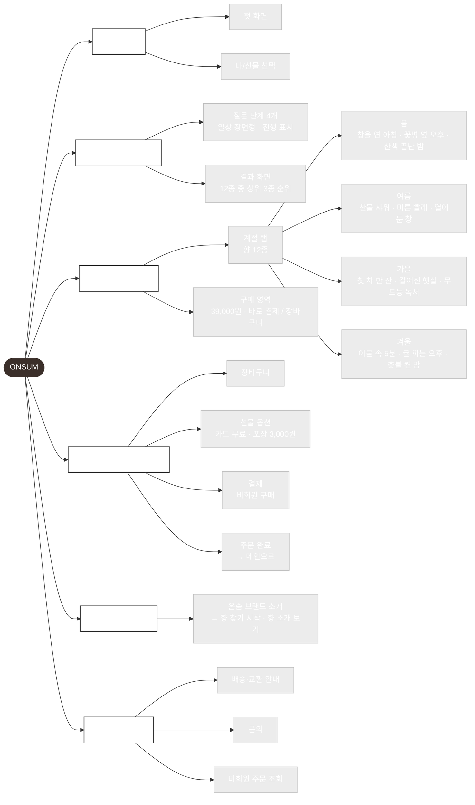

# 03. 온숨(ONSUM) 사이트맵

> 01-site-purpose.md와 02-site-structure.md를 바탕으로 만든 사이트맵입니다.
> 현재 추후 결정 항목은 없습니다. 새로 미정 항목이 생기면 Figma에서 점선 박스와 '추후 결정'으로 표시합니다.

---

## 1. Figma

| 항목 | 내용 |
|---|---|
| 파일 | [ONSUM](https://www.figma.com/design/zFu9WgqZNCjyWiAM8oDvrc/ONSUM?node-id=0-1) |
| 페이지 | `Sitemap` (node 4:2) |
| 프레임 이름 | `ONSUM Sitemap` (node 4:3, 1440 × 1452) |
| 프레임 링크 | [ONSUM Sitemap](https://www.figma.com/design/zFu9WgqZNCjyWiAM8oDvrc/ONSUM?node-id=4-3) |

**표기 규칙**

- 페이지: 흰색 실선 박스
- 내부 섹션: 연회색 작은 박스
- 미정 항목: 점선 박스 + '추후 결정' (현재 없음)
- 가로 계층도: 왼쪽에서 오른쪽으로 홈 → 페이지 → 섹션 → 하위 섹션, 연결선으로 이어짐

## 2. 사이트맵 (가로 계층도)



## 3. 사이트맵 (텍스트)

```
ONSUM
├─ ① 메인
│   ├─ 첫 화면
│   └─ 나/선물 선택
├─ ② 향 찾기 테스트
│   ├─ 질문 단계 (일상 장면형 4개, 진행 표시 / 선물용은 받는 사람 기준)
│   └─ 결과 화면 (12종 중 상위 3종 순위, 대표 색·분위기 사진)
├─ ③ 향 소개(상품)
│   ├─ 계절 탭 (향 12종, 탭마다 아침·낮·밤 3종)
│   │   ├─ 봄: 창을 연 아침 · 꽃병 옆 오후 · 산책 끝난 밤
│   │   ├─ 여름: 찬물 샤워 · 마른 빨래 · 열어둔 창
│   │   ├─ 가을: 첫 차 한 잔 · 길어진 햇살 · 무드등 독서
│   │   └─ 겨울: 이불 속 5분 · 귤 까는 오후 · 촛불 켠 밤
│   └─ 구매 영역 (12종 동일가 39,000원, 바로 결제 / 장바구니 담기)
├─ ④ 장바구니·주문·결제
│   ├─ 장바구니
│   ├─ 선물 옵션 (메시지 카드 무료, 선물 포장 유료 3,000원)
│   ├─ 결제 (비회원 구매)
│   └─ 주문 완료 → 메인으로 돌아가기
├─ ⑤ 브랜드 소개
│   └─ 온숨 브랜드 소개 → 향 찾기 시작(주) · 향 소개 보기(보조)
└─ ⑥ 고객 안내 → 메인으로 돌아가기
    ├─ 배송·교환 안내
    ├─ 문의
    └─ 비회원 주문 조회
```

## 4. 메뉴 위치

| 위치 | 메뉴 |
|---|---|
| 상단 메뉴 | 브랜드 소개 · 향 찾기 · 향 소개 · 장바구니 ('향 찾기'는 ① 메인의 나/선물 선택으로 이동) |
| 하단(푸터) | 배송·교환 안내 · 문의 · 비회원 주문 조회 |
